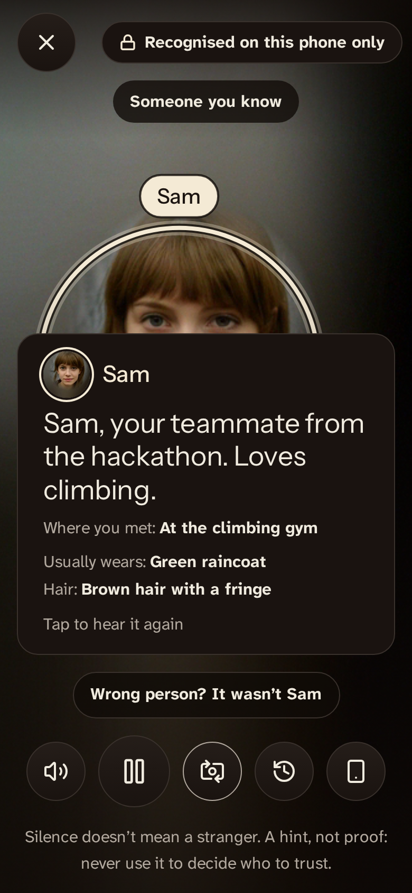
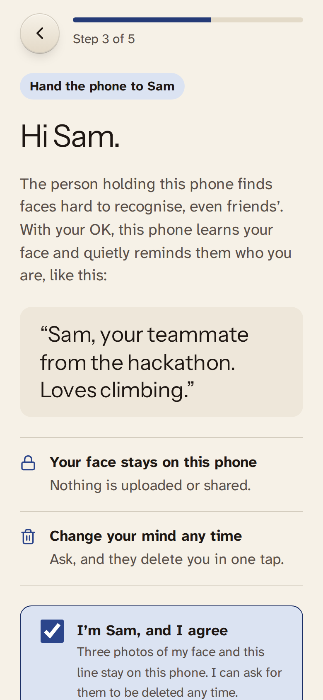
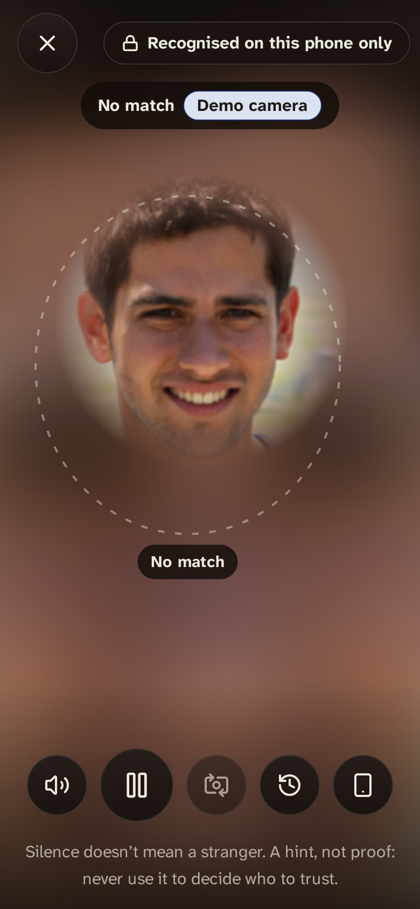
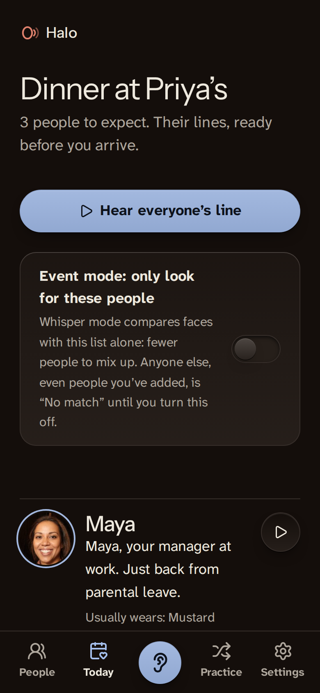

# Halo

**A quiet voice for faces you know.**

**Try it: https://halo.dualmindlab.tech** (open it on a phone; the demo mode uses AI-generated faces).

Halo is a phone web app for people with face blindness (prosopagnosia). You add people you know, with their own agreement. When the camera is sure it's one of them, an earbud says who they are and how you know them: *"Raj, your neighbour. Knee surgery last month."* Faces, face fingerprints and photos never leave the phone.

<p>
  
  
  
  
</p>

Every face in this repository, the app's demo mode and the fake-camera clips is an AI-generated image of a person who does not exist ([credits](CREDITS.md)). Halo is a prototype, tested so far mainly on AI-generated faces.

## Contents

- [Who it's for](#who-its-for) · [What already exists](#what-already-exists)
- [What it does](#what-it-does) · [Privacy model](#privacy-model) · [Optional Enhanced mode](#optional-enhanced-mode-off-by-default) · [Honest limits](#honest-limits)
- [Run it](#run-it) · [Tests and evidence](#tests-and-evidence) · [Deploying](#deploying)
- [How it works](#how-it-works) · [How it was made](#how-it-was-made) · [Design](#design) · [Project layout](#project-layout) · [Credits and licence](#credits-and-licence)

## Who it's for

Lifelong face blindness affects roughly 2% of people ([Kennerknecht et al. 2006](https://doi.org/10.1002/ajmg.a.31343): 2.47% of 689 students; later estimates range from 0.64% to 5.42% depending on the cut-off, [DeGutis et al. 2022](https://bu.edu/ballab/pubs/DeGutis2022_Ax2.pdf)). People with it often can't place neighbours, colleagues or relatives, and get by on voices, clothes, context or a partner's help. In their words, from public posts on r/prosopagnosia:

> "What we need is some dude saying in our ears "yes , you know that person it's insert name""
> and "My boyfriend does it for me. I need that but like, in my earphones, for when he's not around."
> u/Adventurous_Kiwi, [thread](https://www.reddit.com/r/prosopagnosia/comments/1th3clh/)

> "The contact cards would not help me, unfortunately. I'd only be practicing to recognize that specific picture of my friend."
> u/HereForMcCormackAMA, [thread](https://www.reddit.com/r/prosopagnosia/comments/1v0faz5/)

> "I'd like it to have only a database of people I actually care about... I want to know who they are and where I met them before. ... But just seeing the names of people standing in line next to me at the store or walking down the street would be both useless and overwhelming."
> u/EinsTwo

And the objection Halo has to answer:

> "What would actually be useful is something that could recognize and label someone as I'm speaking to them, but I feel like that's more in the realm of smart glasses than phones because I'm not going to go around pointing my phone at everyone."
> u/Ilaxilil, [thread](https://www.reddit.com/r/prosopagnosia/comments/1th3clh/)

Pocket mode is Halo's answer for now (the phone worn at chest height, screen dark); glasses would be the better one, and are listed under later work in `scope.md`. Quotes are shown word for word.

## What already exists

Halo is not the first tool to name a taught face:

- [OrCam MyEye](https://knowledgebase.orcam.com/knowledge/how-do-i-use-face-recognition-on-my-orcam-myeye) and [Envision's Teach a Face](https://support.letsenvision.com/hc/en-us/articles/8118364337297) recognise faces the user has taught, for blind and low-vision users, on dedicated hardware or glasses.
- [NameVault](https://apps.apple.com/app/id1525602410) helps people practise names from photos.
- SocialRecall was a 2018 concept for prosopagnosia; Meta's idea of name tags for its glasses is unreleased.

How Halo differs: it is built for people who **see** but can't place faces. It says *how you know* someone, not just a name; it shows the cues people with face blindness already use (clothes, hair, voice); it briefs you before an event and can look only for the people expected there; it can hang at chest height in pocket mode instead of being held up; it lets you practise from cues; the person being added reads their line and agrees themselves; and it runs free in an ordinary phone browser, with nothing uploaded.

## What it does

1. **A short tour and an earbud check.** Halo speaks aloud only after you confirm you heard a test line in your earbud; until then it buzzes and shows the name.
2. **Add someone, with their yes.** Their name (and whether they are a child), a typed note that becomes a one-line whisper on the phone, then **you hand them the phone**: they read the exact line and tick "I'm [name], and I agree". If they aren't there, a link lets them answer on their own phone; the answer comes back in a link, and nothing goes through a server. Then three to five photos with an oval guide and a light check, and optional cue notes. Halo warns about look-alikes, keeps at most 50 people and 5 new a day, and marks a consent older than a year "Ask again".
3. **Whisper mode.** A full-screen camera with "Recognised on this phone only". Each face is tracked and given one of three states:
   - **Confident** (one face, at least a second and five frames, one of them facing the camera, clearly closer to one person than to anyone else): a light halo, a caption with the line and cues, and the whisper.
   - **Maybe**: a dotted ring and "Could be Raj? Check: green parka", never spoken. Children and look-alikes never go past this.
   - **No match**: a faint outline. "Silence doesn't mean a stranger."
   "Who was that?" lists the last five, in memory only.
4. **Pocket mode, for not holding a phone up.** Hang the phone at chest height (a lanyard or a shirt pocket, camera facing out) and tap the pocket button: the screen goes near-black and is kept awake with the Wake Lock API, the camera keeps running, and whispers go to your earbud. Without an earbud check, Halo buzzes a code instead: two short for someone you added, three for someone on today's list, one long for "could be". Double-tap or **Wake the screen** to come back.
5. **Today's list and event mode.** Pick who you'll see, then read or hear their lines before you walk in. Turn on **Event mode** and Whisper mode compares faces with that short list only: fewer people to mix up, and everyone else is "No match" until you turn it off.
6. **Where you met.** Each person can carry a line such as "At the climbing gym; last saw him at Anu's wedding", typed or dictated. It shows under the whisper and in today's list.
7. **Say it all at once.** On the first step of adding someone you can say one sentence ("This is Raj, my neighbour, had knee surgery, wears a green parka, we met at the climbing gym") and Halo's rules fill the name, the note, the cues and where you met, for you to check. Typing stays the default.
8. **Quiet hours and never whisper.** Set hours when nothing is said aloud (a buzz and the caption instead), and mark any person "Never whisper": Halo still shows who it is, but says nothing and doesn't buzz.
9. **A helper.** Send a partner, parent or friend the helper page. They prepare a card for someone you'll meet (name, how you know them, cues, where you met) and send it back as a link, text only. You check it and add the person when you meet; the person still reads their line and says yes, and the photos are taken on your phone.
10. **Practice.** Name people from their cues (or a photo if that helps), on a gentle spaced schedule. No streaks.
11. **Settings.** Voice, chime, buzz or silent; short, warm or full whispers; volume and speed; strictness; repeat interval; pause; quiet hours; bigger text; higher contrast; light, dark or automatic theme; backups locked with a passphrase (restoring lets you choose who comes back); **Delete everything**.
12. **Privacy and honest limits.** A ledger of everything that has left the phone (by default: nothing) and the six limits below.
13. **Halo in 60 seconds.** `/app/#/try` (or **See it in 60 seconds** on the first screen) prepares the three AI-generated sample people on the phone and runs the demo camera with a short guide: two people recognised, one face that was never added. No camera, no tour needed; nothing is said aloud unless you turn it on.
14. **A landing page** at `/` (the app is at `/app/`) that speaks a real whisper in the browser voice and turns a typed note into a whisper with the app's own rules.
15. **The privacy, written out.** [`/privacy/`](privacy/index.html) says what is kept, where, for how long, what Enhanced mode sends, what is never sent and whose consent it is; [`/terms/`](terms/index.html) and [`/safety/`](safety/index.html) say what Halo is not, what the user is responsible for, and what to do when it's wrong. Linked from the landing page and Settings. A test fails if the code drifts from the privacy page.
16. **Your data** (`#/data`): everything stored on the phone, with counts; remove one person; export an encrypted backup; delete everything; and a two-tap **Wipe now** that clears the database and its key, the offline cache, the service worker and settings at once.
17. **A lock.** Optionally open Halo with a passcode (only a salted hash is kept) or the phone's own fingerprint or face lock through WebAuthn, with auto-lock after idle or time away. It is a lock screen, not extra encryption, and the app says so.
18. **Wrong person?** A tap under a caption notes a wrong match on the phone; Settings turns the reports into suggestions (Careful, hold that person at "Could be", new photos).
19. **Help** (`#/help`): getting the camera and microphone back, light, distance, glasses and masks, and plain answers. Camera and dictation errors link to it.
20. **Hindi and Gujarati** for the main flow (machine-translated and flagged; see [`docs/i18n.md`](docs/i18n.md)), **Battery saver** (about two reads a second instead of six; nothing while hidden; measured in [`docs/accuracy.md`](docs/accuracy.md)), and an installable app that offers updates with a **Reload** button instead of switching mid-conversation.

## Privacy model

| | Where it lives |
|---|---|
| Camera frames | Analysed in memory in the browser, never stored or sent |
| Face fingerprints (128 numbers per photo) | IndexedDB on this phone, AES-GCM encrypted |
| Names, notes, whispers, cues, one small thumbnail, today's list, practice | IndexedDB on this phone, AES-GCM encrypted |
| Encryption key | Created by the browser as non-extractable: the page can use it, nobody can export it |
| Faces you didn't add | Compared for a moment, then dropped. Never stored or named |
| Settings | localStorage, nothing personal |

- No account, no server for faces, no analytics, no third-party scripts or fonts. Model weights, WebAssembly and fonts are served by the site itself. The Content-Security-Policy allows `connect-src 'self'` only, and `npm run build` fails if the build loads anything from another origin.
- No API key is needed, and none is in this repository.
- Works offline after the first visit (a service worker caches the app and the face models).
- **Dictation** (the note, "say it all at once", where you met) is optional and labelled: typing is the default, because a browser's speech recognition may send audio to the browser maker.
- **Written out in full** on the [privacy page](privacy/index.html), checked against the code by `tests/unit/privacy-drift.test.ts`. What could go wrong, and what the app does about it: [`docs/threat-model.md`](docs/threat-model.md).
- **Helper cards and consent links** carry text only, in the part of the link after `#`, which browsers never send to a server. They never contain photos or face fingerprints; whatever app you use to send the link can see its text, like any message.
- **Delete everything** removes the database and the key together.

## Optional Enhanced mode (off by default)

For people who want a more natural voice or whispers in another language. Turning it on opens a sheet that lists exactly what would leave the phone: the whisper line to voice or translate, and, only if you ask the cloud to write a line, the typed name and note. **Never faces, photos or face fingerprints.** Every request is recorded in the on-phone ledger. The voice clip is made once when you save, stored encrypted with the person, and plays offline afterwards.

The server side is one Cloudflare Worker on the same origin ([`worker/`](worker/README.md)) using Workers AI: MeloTTS for voice, IndicTrans2 and m2m100 for translation, Llama 3.2 3B to write a line, Whisper for an optional short voice note. It checks the origin, signs sessions, enforces strict schemas and size caps, rate-limits per address, stores nothing and logs no content. It has unit tests with Workers AI mocked; **it is live at https://halo.dualmindlab.tech** with its measured results in [`worker/README.md`](worker/README.md).

## Honest limits

These six statements appear word for word on the landing page and in the app:

1. A hint, not proof. It can name the wrong person, especially relatives, look-alikes and children. Never use it to decide who to trust or let in.
2. Silence doesn't mean a stranger. Dim light, side angles, masks, new glasses or a haircut can stop a match.
3. It works better for some faces than others. Open face models make more mistakes for darker-skinned and East Asian faces, women, children and older people.
4. It only knows people who said yes. It can't look anyone up. Each face in view is measured for a moment, checked against your list, then forgotten.
5. The app records that you asked them, but it can't check. Remove anyone the moment they ask.
6. A prototype, tested so far mainly on AI-generated faces, not yet with people who have face blindness. Without earbuds, your phone speaks out loud.

What has been measured, what it doesn't prove and how to test it properly: [`docs/accuracy.md`](docs/accuracy.md). The face library, [@vladmandic/face-api](https://github.com/vladmandic/face-api), was archived in February 2025; it still works, and a move to a maintained engine is planned.

## Run it

Needs Node 20 or newer (and ffmpeg for the fake-camera clips and the mp4 videos).

```bash
./run.sh            # install (first run), build, serve on http://localhost:4173
```

The landing page is at http://localhost:4173/ and the app at http://localhost:4173/app/. It is served with the production headers (strict CSP). The camera works on `localhost`; on a phone, open it through an HTTPS address (the camera needs a secure page).

No camera or second person handy? Open http://localhost:4173/app/#/try for **Halo in 60 seconds**, or tap **Try with sample people**, then **Open the demo camera**.

| Command | What it does |
|---|---|
| `./run.sh` | Build and serve |
| `./run.sh fake-camera [friend\|street]` | Also open Chromium with a fake camera playing "Sam", an AI-generated face (`street` adds a face that was never added). Needs a display; on a server use `xvfb-run` |
| `./run.sh test` | Unit tests and end-to-end tests |
| `./run.sh screens` | Every screen in light and dark, phone and desktop, plus contact sheets |
| `./run.sh record` | The app walkthrough, the landing scroll and the 60-second try videos |
| `./run.sh accuracy` | Match distances on the synthetic faces |
| `npm run perf` | Frames a second in Whisper mode: normal, battery saver, hidden (`eval/performance.json`) |

## Tests and evidence

- **Unit (90, Vitest):** the whisper writer and styles; the matcher and the three-state tracker (steady view, margin, face swap, children held at maybe); the encrypted vault and meta records; backups (wrong passphrase, hidden content); practice scheduling; light and pose hints; consent links and helper cards; quiet hours across midnight, never-whisper people, buzz codes and the earbud check; event-mode filtering; splitting a spoken intro into name, note, cues and where you met; the Enhanced mode Worker with Workers AI mocked (sessions, origin and schema checks, size caps, rate limit, daily ceiling, graceful failures); the privacy page against the code (CSP, network calls, Enhanced routes, the Worker's limits); passcode hashing; wrong-match suggestions; translation coverage.
- **End to end (25, Playwright with Chromium's fake camera):** add a person with their yes and hear their whisper; edit, check the database holds ciphertext, delete everything; sample people recognised while the never-added face stays "No match" (distances logged); works offline after the first visit; consent by link round trip; default mode never calls the server; Enhanced mode sends only short text that appears in the ledger; no request to any other origin (landing page and app); the strict security headers; Halo in 60 seconds before the tour and with no camera; pocket mode (dark, kept awake, buzz codes, nothing aloud before the earbud check); event mode (only the person on the list is named over a 34 s demo cycle); spoken enrolment filling every field, where you met in the caption and a never-whisper person staying silent; helper cards round trip with no request sent; accessibility (axe-core WCAG 2.2 A and AA on every page and screen in light and dark, keyboard focus, reduced motion); the privacy, terms and safety pages linked from the landing page and the app; Your data and Wipe now (no database, cache, service worker or storage left); a passcode lock storing only a hash; the phone lock through a virtual WebAuthn authenticator; a wrong-match report becoming a suggestion; Hindi and Gujarati; axe on the documents, Your data, Help and the lock screen.
- **Evidence:** [`docs/shots/`](docs/shots/): every screen in four variants ([phone light](docs/shots/contact-sheet-phone-light.png), [phone dark](docs/shots/contact-sheet-phone-dark.png), [desktop light](docs/shots/contact-sheet-desktop-light.png), [desktop dark](docs/shots/contact-sheet-desktop-dark.png)), the [app walkthrough](docs/shots/walkthrough.mp4) (headless, no sound) with stills and a timeline in [`docs/shots/walkthrough/`](docs/shots/walkthrough/), the [landing scroll](docs/shots/landing-scroll.mp4) and [Halo in 60 seconds](docs/shots/try-60-seconds.mp4). The palette change is shown before and after in [`docs/shots/recolour/`](docs/shots/recolour/).
- **Accuracy:** [`docs/accuracy.md`](docs/accuracy.md) and [`eval/accuracy-synthetic.json`](eval/accuracy-synthetic.json). On the synthetic set, same person 0.05 to 0.21 and different people 0.70 or more; this says nothing yet about real people in real rooms.
- **Device test:** [`docs/device-test.md`](docs/device-test.md) lists what to check on a real phone.

## Deploying

The build is a static site with a strict CSP that works at the domain root. `wrangler.jsonc` serves `dist/` as Workers static assets (single-page fallback, `/api/*` to the optional Worker). Steps are in [`worker/README.md`](worker/README.md). Live deploy: `npm run build`, set `SESSION_SECRET`, `npx wrangler deploy`; the `routes` entry creates the `halo.dualmindlab.tech` custom domain.

## How it works

```
camera frame -> TinyFaceDetector -> 68-point landmarks -> FaceRecognitionNet -> 128-number fingerprint
                (face-api with TensorFlow.js on WebGL, then WebAssembly, then CPU, all in the browser)
fingerprint -> nearest person on your list, or on today's list in event mode (distance and lead over the runner-up)
            -> FaceTracker: one track per face, three states over time
               confident -> halo, caption, and the rules decide: whisper (stored clip or the phone's voice),
                            a buzz code (quiet hours, before the earbud check, pocket mode without an earbud)
                            or nothing (a never-whisper person)
               maybe     -> dotted ring, "Could be ...?", silent
               no match  -> faint outline; the fingerprint is dropped
```

- **Stack:** TypeScript, React 19, Vite 7 (a multi-page static site: `/`, `/app/`, `/consent/`, `/helper/`), [@vladmandic/face-api](https://github.com/vladmandic/face-api), [idb](https://github.com/jakearchibald/idb), Web Crypto, Web Speech API, Web Audio, the Vibration and Screen Wake Lock APIs, lucide icons, self-hosted fonts.
- **Key files:** [`src/lib/faceEngine.ts`](src/lib/faceEngine.ts), [`src/lib/matcher.ts`](src/lib/matcher.ts), [`src/lib/rules.ts`](src/lib/rules.ts) (quiet hours, never whisper, buzz codes, event mode), [`src/lib/intro.ts`](src/lib/intro.ts), [`src/lib/cardLink.ts`](src/lib/cardLink.ts), [`src/lib/vault.ts`](src/lib/vault.ts), [`src/lib/whisper.ts`](src/lib/whisper.ts), [`src/lib/say.ts`](src/lib/say.ts), [`src/lib/consentLink.ts`](src/lib/consentLink.ts), [`src/lib/enhanced.ts`](src/lib/enhanced.ts), [`src/screens/WhisperMode.tsx`](src/screens/WhisperMode.tsx), [`src/screens/Enrol.tsx`](src/screens/Enrol.tsx), [`worker/index.ts`](worker/index.ts).
- **The name** lives in one place, [`brand.config.json`](brand.config.json): the pages, manifest, app and scripts read it from there.

## How it was made

Built for Devpost's [Build With AI: Basics](https://learn-ai-basics.devpost.com/) with the [Devpost Learn skill pack](https://github.com/challengepost/learn-ai-basics) (`npx skills add challengepost/learn-ai-basics --all -y`), run in an AI coding agent. The idea, the users' problem, the privacy rules, the name and the product decisions are Harsh's; the agent wrote the planning documents and the code from his written brief, and each slice was verified with tests before it was committed.

- `1-start`: a learner profile, kept out of the repository as the skill intends.
- `2-scope`: [`scope.md`](scope.md), the kernel, who it's for, what was cut.
- `3-prd`: [`prd.md`](prd.md), the journey, screens and behaviour.
- `4-spec`: [`spec.md`](spec.md), stack, components, data model, failure modes.
- `5-build`: [`devpost/checklist.md`](devpost/checklist.md), nine verified slices and the revisions the build forced.
- `6-ship`: [`docs/submission-checklist.md`](docs/submission-checklist.md); the description, the video and the form answers are Harsh's own.

`scope.md`, `prd.md` and `spec.md` are the single source and describe the app as it is now; `devpost/` links to them.

## Design

Designed with the [Hallmark](https://github.com/Nutlope/hallmark) design skill, installed in this project only: the structure of its Ribbon theme (Instrument Sans over Atkinson Hyperlegible Next, machined controls lit from above) in a palette taken from Ajrakh, the block-printed cotton of Kutch and Sindh: undyed cotton for paper, iron black for ink and night, indigo for what you act on, madder for the mark, and the halo as the resist white, the part of the cloth left light. All colours live in one file, [`src/styles/palette.css`](src/styles/palette.css). Every screen was swept with Hallmark's `sloplint` (static and rendered) to zero failures, and the landing page went through two fresh-context reviews. The system, the decisions and the record of the sweeps: [`docs/design.md`](docs/design.md).

## Project layout

```
index.html, landing/   the landing page
app/, src/             the app: screens, face engine, tracker, vault, voice, consent, Enhanced client
consent/               the page the person being added opens from a link
privacy/, terms/, safety/   the written privacy, terms and safety pages
helper/                the page a helper uses to prepare a card
worker/                the optional Enhanced mode Worker (source only)
public/                sample faces (AI-generated) and credits, service worker, icons, _headers, robots.txt
scripts/               model copier, fake-camera clips, the header-aware server, external-request check, icons, contact sheets
tests/                 unit tests and Playwright tests and recordings
docs/                  accuracy, design, device test, submission checklist, screenshots and videos
scope.md, prd.md, spec.md, devpost/   the Devpost Learn planning documents and build checklist
```

## Credits and licence

MIT, see [LICENSE](LICENSE). Third-party code, models, fonts, faces and the design skill are listed in [CREDITS.md](CREDITS.md).
