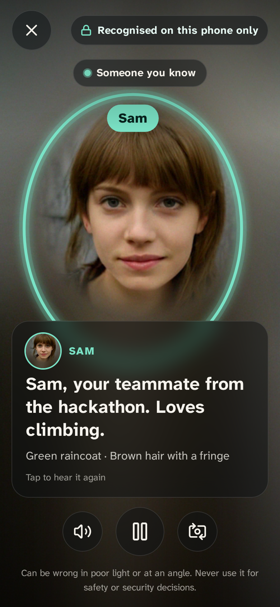
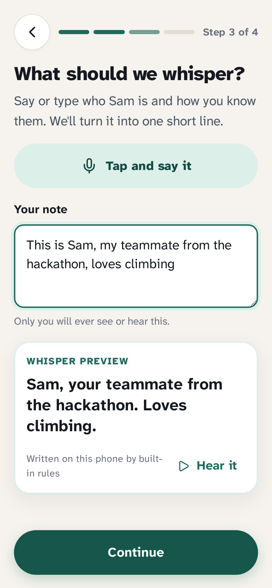
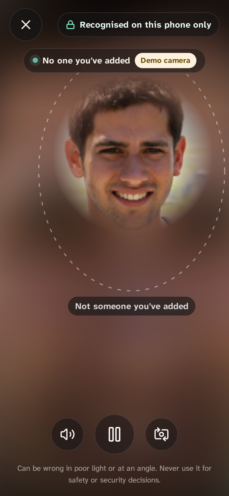

# Face Whisper

**Quiet, on-device reminders of who someone is, for people with face blindness.**

Point your phone at someone you've added (with their agreement) and an earbud whispers who they are and how you know them: *"Raj, your neighbour. Knee surgery last month."* Faces never leave the phone.

<p>
  
  
  
</p>

All faces in this README, the demo mode and the fake-camera clips are AI-generated images of people who do not exist ([credits](public/demo/faces/CREDITS.md)).

## The problem

About 2% of people have prosopagnosia (face blindness): they can't recognise familiar faces, even of colleagues, neighbours or relatives. People in the community describe exactly what they want:

> "What we need is some dude saying in our ears 'yes, you know that person it's &lt;name&gt;'"
> — [r/prosopagnosia](https://www.reddit.com/r/prosopagnosia/comments/1th3clh/)

> "glasses that would tell me who people are and how I know them"
> — [r/prosopagnosia](https://www.reddit.com/r/prosopagnosia/comments/1r58f5g/)

> "photo contact cards don't help, I'd only be practicing to recognize that specific picture"
> — [r/prosopagnosia](https://www.reddit.com/r/prosopagnosia/comments/1v0faz5/)

Nothing like this ships today: a name-tag feature for smart glasses has been talked about but not released, and the rest are research prototypes.

## What it does

1. **Welcome.** A one-screen promise: faces stay on this phone, only people who said yes, honest limits.
2. **Enrol someone, with consent.** Name, a consent tick ("they agreed to be added"), 3 to 5 photos from the camera, a short spoken or typed note, and optional cue notes (usual clothes, hair, glasses, voice), because people with face blindness often recognise others by those.
3. **Note to whisper.** "This is Raj, my neighbour, had knee surgery last month" becomes "Raj, your neighbour. Knee surgery last month." Written by built-in rules on the phone (no key, no network); if the browser has an on-device language model, it can write it instead. Always editable.
4. **Whisper mode.** Full-screen camera with a "Recognised on this phone only" badge. When an enrolled face is steady in view, a soft ring settles around it, the whisper is spoken quietly (a soft chime first) and a caption shows the whisper and cue notes. Faces that aren't enrolled get a faint outline and "Not someone you've added". Nothing about them is kept.
5. **Manage.** People list, edit any field, add photos, delete a person, and **Delete everything**.
6. **Try it alone.** Sample people with AI-generated faces and a demo camera that cycles through them plus one stranger.

## Privacy model

| | Where it lives |
|---|---|
| Camera frames | Analysed in memory in the browser, never stored or sent |
| Face fingerprints (128 numbers per photo) | IndexedDB on this device, AES-GCM encrypted |
| Names, notes, whispers, cues, one small thumbnail | IndexedDB on this device, AES-GCM encrypted |
| Encryption key | Created by the browser as non-extractable: page code can use it but nobody can read or export it |
| Unknown faces | Compared, then discarded. Never stored or named |
| Settings (voice, volume, theme) | localStorage, nothing personal |

- No server, no account, no analytics, no third-party scripts or fonts. Model weights, fonts and WebAssembly are served by the app itself, and a service worker keeps it working offline after the first visit.
- No API key is needed, and none is in this repository.
- **Dictation caveat:** voice notes use the browser's speech recognition. The app asks for on-device recognition where the browser supports it; some browsers (for example Chrome on many phones) send the audio to the browser maker's speech service. Typing keeps everything local. The in-app privacy page says this plainly.
- **Delete everything** removes the database and the key together.

## Honest limits

- Poor light, backlight, steep angles, masks, new glasses or a new beard can stop a match, or rarely cause a wrong one. Relatives and look-alikes can be confused.
- To stay calm and avoid wrong names, it only whispers when a face is closer than a strict threshold to one person, clearly closer to them than to anyone else, and steady for 3 of the last 4 frames. When unsure it stays silent.
- It is a gentle reminder, **not** identification. Never use it for safety, security or identity decisions.
- Browser storage is per browser: clearing site data or a private window loses everything.

## How it works

```
camera frame ──► TinyFaceDetector ──► 68-point landmarks ──► FaceRecognitionNet ──► 128-number fingerprint
                     (face-api, TensorFlow.js on WebGL, WebAssembly or CPU, all in the browser)
fingerprint ──► nearest enrolled person (Euclidean distance < 0.45, margin 0.04)
            ──► steady 3 of 4 frames? ──► soft ring + caption + browser speech (Web Speech API)
            └─► no match ──► "Not someone you've added", fingerprint dropped
```

- **Stack:** TypeScript, React 19, Vite 7, [@vladmandic/face-api](https://github.com/vladmandic/face-api) (TinyFaceDetector, tiny landmarks, FaceRecognitionNet), [idb](https://github.com/jakearchibald/idb), Web Crypto, Web Speech API, [Atkinson Hyperlegible Next](https://www.brailleinstitute.org/freefont/) (a typeface designed for low-vision readers), lucide icons.
- **Measured on the synthetic faces:** same person 0.08 to 0.33, the stranger 0.78 to 0.82 from everyone. Detection takes about 0.1 s a frame with WebAssembly on a 2-core ARM server; phones with WebGL are faster.
- Key files: [`src/lib/faceEngine.ts`](src/lib/faceEngine.ts), [`src/lib/matcher.ts`](src/lib/matcher.ts), [`src/lib/vault.ts`](src/lib/vault.ts), [`src/lib/whisper.ts`](src/lib/whisper.ts), [`src/screens/WhisperMode.tsx`](src/screens/WhisperMode.tsx), [`src/screens/Enrol.tsx`](src/screens/Enrol.tsx).

## Run it

Needs Node 20+ (and ffmpeg for the fake-camera clips).

```bash
./run.sh                      # install (first run), build, serve on http://localhost:4173
```

Open http://localhost:4173. The camera works on `localhost`; for a phone, open the app through an HTTPS tunnel to that port (the camera needs a secure page).

| Command | What it does |
|---|---|
| `./run.sh` | Build and serve the app |
| `./run.sh fake-camera` | Also open Chromium with a fake camera playing "Sam", an AI-generated face (`fake-camera street` adds a stranger). Needs a display; on a server use `xvfb-run` |
| `./run.sh record` | Record the full walkthrough headless: `docs/shots/walkthrough.webm` / `.mp4`, 20 screenshots and `timeline.json` |
| `./run.sh test` | Unit tests (Vitest) and end-to-end tests (Playwright with the fake camera) |

No camera or friend handy? Tap **Try with sample people**, then **Open the demo camera**.

### Tests

- Unit (24): the whisper writer, the matcher and tracker, the encrypted vault (ciphertext, delete, wipe).
- End to end (5, Playwright + Chromium fake camera): enrol and recognise; edit, check the database holds ciphertext, delete everything; sample people recognised while the stranger stays unknown (with distances logged); works offline after the first visit; the recorded walkthrough.

## How it was built: the Devpost Learn skills

This project was started from an empty folder for the [Build With AI: Basics](https://learn-ai-basics.devpost.com/) hackathon, using the [Devpost Learn skill pack](https://github.com/challengepost/learn-ai-basics) (`npx skills add challengepost/learn-ai-basics --all -y`) in an AI coding agent.

- `1-start` → learner profile (kept out of the repo, as the skill intends).
- `2-scope` → [`devpost/scope.md`](devpost/scope.md): the kernel, who it's for, the proof-of-concept boundary.
- `3-prd` → [`devpost/prd.md`](devpost/prd.md): the core journey, screens, behaviours and acceptance criteria.
- `4-spec` → [`devpost/spec.md`](devpost/spec.md): stack, components, data model, failure modes.
- `5-build` → [`devpost/checklist.md`](devpost/checklist.md): four verified slices, each committed, with the plan revisions the build forced (for example the WebAssembly fallback).

The idea, the users' problem and the privacy rules are Harsh's. The planning interviews were answered from his written brief, the coding agent wrote the code under that plan, and every slice was verified with tests before it was committed. `scope.md`, `prd.md` and `spec.md` are also linked at the repository root.

## Project layout

```
src/lib/        face engine, matcher, encrypted vault, whisper writer, voice, dictation, demo mode
src/screens/    Welcome, Home, Enrol, WhisperMode, Person, Settings, Privacy
src/components/ small UI kit (bottom bar, sheets, switches, toasts)
public/         sample faces (AI-generated) + credits, service worker, icon, manifest
scripts/        model copier, fake-camera clip builder
tests/          unit tests and Playwright end-to-end tests
devpost/        scope, PRD, spec and build checklist from the Devpost Learn skills
docs/shots/     screenshots and the recorded walkthrough
```

## License

MIT, see [LICENSE](LICENSE). Sample faces are public-domain AI-generated images, see [credits](public/demo/faces/CREDITS.md).
