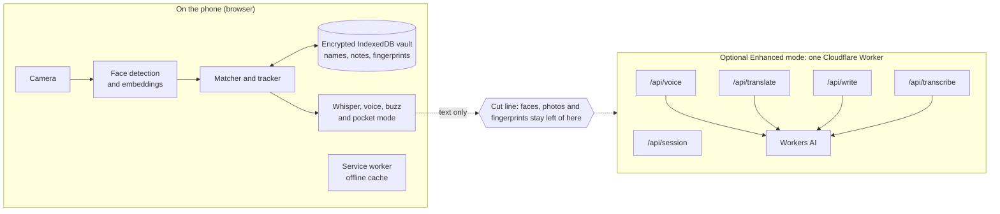
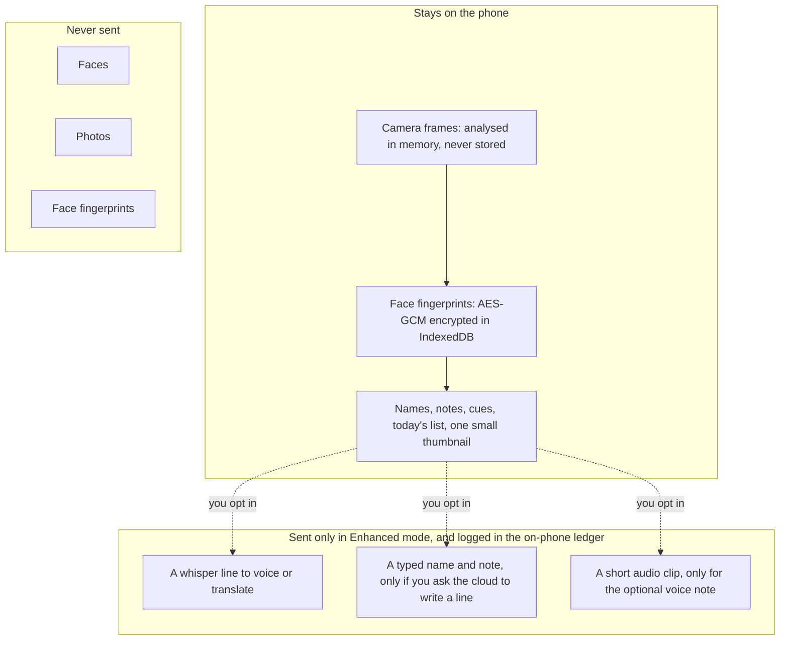
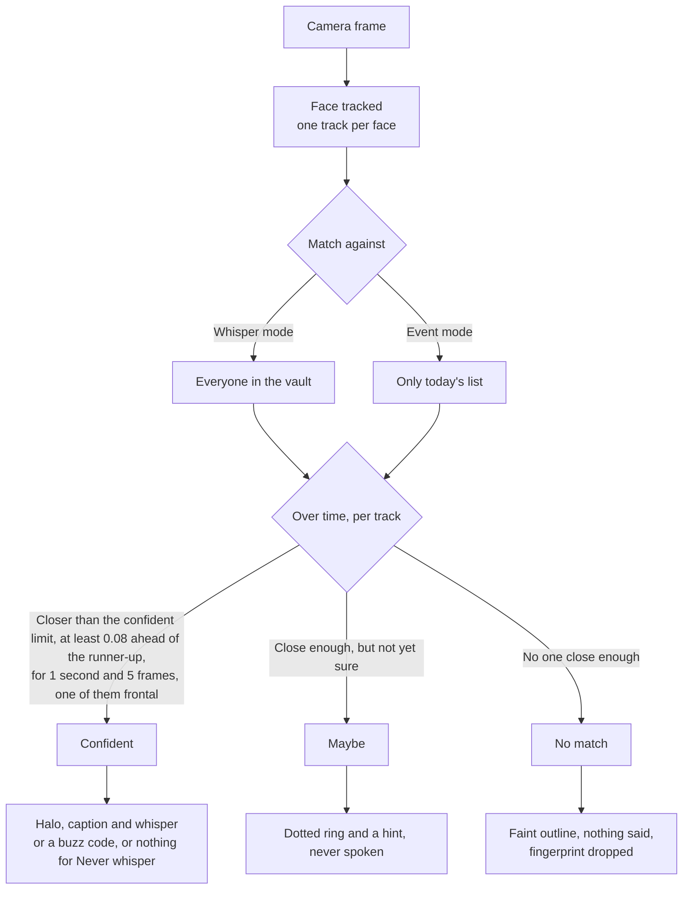
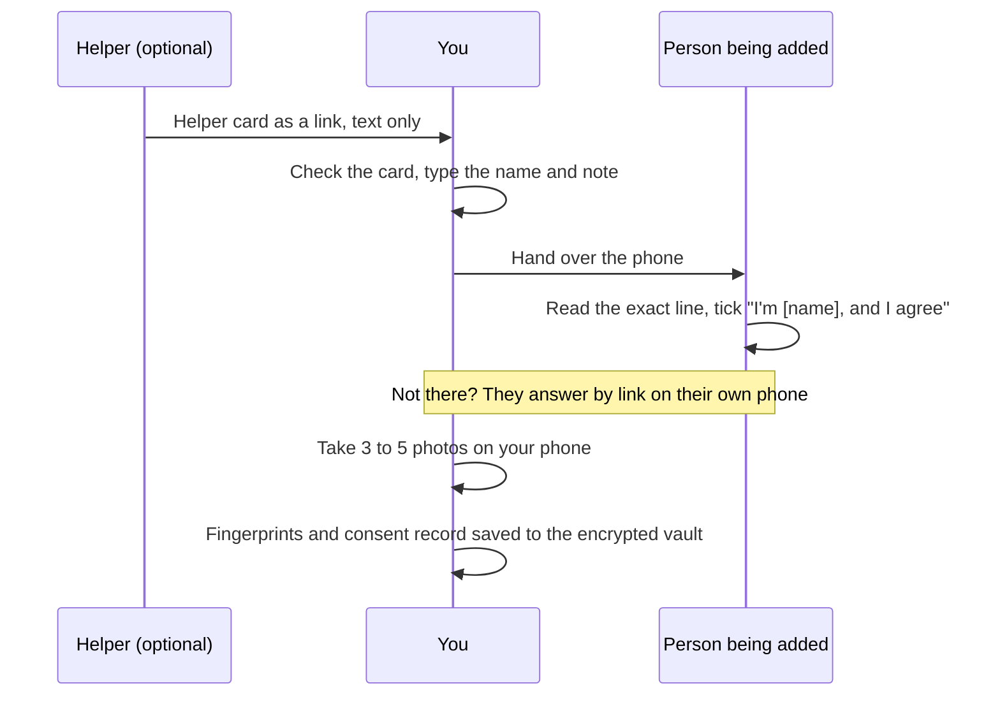
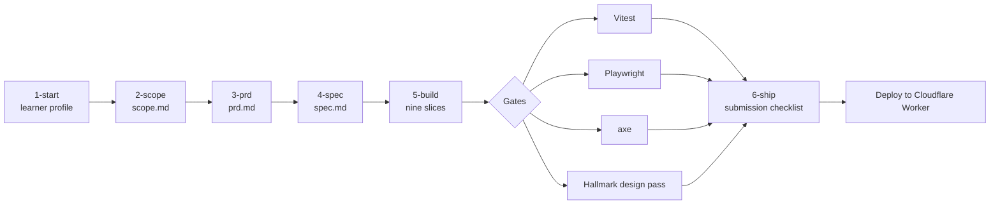

# Halo diagrams

Diagrams moved out of the [README](../README.md). The architecture picture is in the README; these are the flows behind it.

## Architecture

*Everything that sees a face runs inside the phone's browser; the optional Worker only ever receives text or a short audio clip.*

## Privacy data flow

*What stays on the phone, what Enhanced mode sends (off by default), and what is never sent.*

## Recognition flow

*One tracked face becomes Confident, Maybe or No match, and only Confident ever speaks.*

The limits come from `STATE_LIMITS` in [`src/lib/matcher.ts`](../src/lib/matcher.ts): a lead of 0.08 and five frames in both strictness levels, one second in Careful (distance under 0.42 for Confident, 0.5 for Maybe) and 0.9 seconds in Balanced (0.47 and 0.55).

## Add someone with their yes

*The person being added reads the line and agrees, photos are taken on your phone, and a helper card carries text only.*

## Build pipeline

*From the Devpost skill pack's six steps, through nine verified slices and the test and design gates, to a Cloudflare Worker.*

